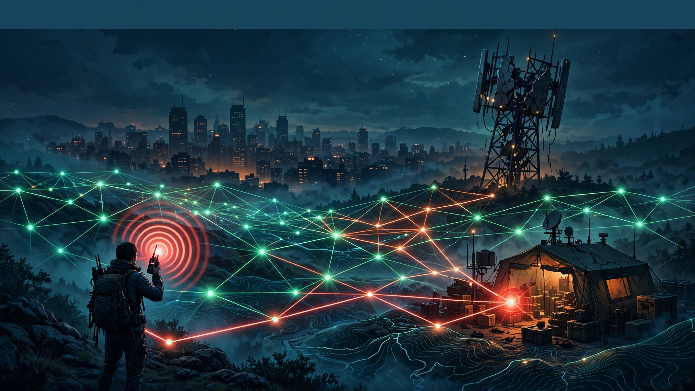
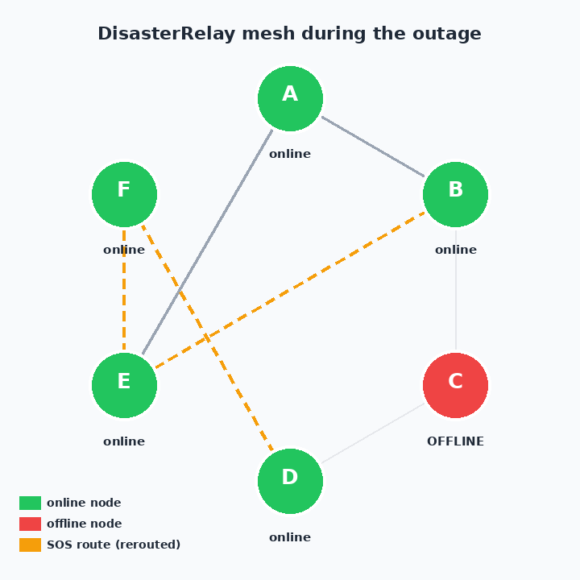
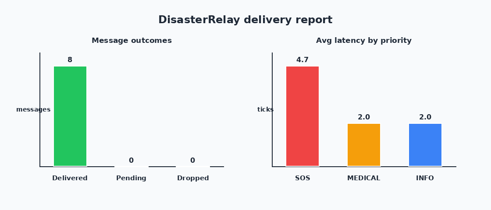

# 📡 DisasterRelay

**Offline-first emergency messenger for when cell networks fail.**

> *UN SDG 11 — Sustainable Cities and Communities: make cities resilient to disasters.*

## The Problem

When an earthquake, hurricane, or flood hits, the first thing to die is the cell network. Towers lose power, backhaul fiber gets cut — and suddenly rescue teams, shelters, and hospitals can't coordinate. SOS calls go nowhere. **People die not from the disaster, but from the silence after it.**

Existing "solutions" need the internet (WhatsApp, SMS gateways) or expensive satellite gear. Volunteers on the ground have cheap radios and phones with Bluetooth/Wi-Fi Direct — but no software that turns those into a *resilient, prioritized* message mesh.

## The Solution

**DisasterRelay** turns every volunteer's device into a mesh node that relays emergency traffic with **zero infrastructure and zero internet**:

- 🔀 **Simulated mesh / P2P relay** — nodes with neighbor lists pass messages hop-by-hop through per-node inboxes (in-memory or JSON-backed).
- 💾 **Store-and-forward queue** — every message persists in the node's on-disk outbox (atomic JSON writes) until a path delivers it. A node can die mid-relay and *nothing is lost*.
- 🚨 **Priority triage: SOS > MEDICAL > INFO** — SOS jumps every queue it lands in, takes shortest-hop priority routes, and gets the biggest TTL/retry budget.
- 🛣️ **Self-healing routing** — every forward recomputes the BFS shortest path from the *current holder*, so when a node drops out the mesh reroutes around it on the very next tick. No A* needed: all links cost 1, so BFS is provably optimal.
- 📊 **Delivery reports** — delivered / pending / dropped counts, per-message hop counts and latency, printed and saved as text + JSON, with charts rendered from the real run.

## Live Demo (copy-paste — runs out of the box)

```bash
# 1. clone & enter
git clone <your-fork> disasterrelay && cd disasterrelay

# 2. install the one dependency
pip install -r requirements.txt

# 3. run the bundled earthquake scenario
python3 -m disasterrelay.cli demo

# 4. run the test suite
python3 -m pytest
```

### What the demo does

A 6-node volunteer radio mesh (`A` command post, `B` north shelter, `C` relay hill, `D` field hospital, `E` south shelter, `F` supply depot) exchanges 8 mixed-priority messages. **Mid-demo, relay node C loses power** — and you watch it happen:

```
[t=3] *** NODE C DROPPED OUT *** (1 message(s) stranded in its store; mesh reroutes around it)
  >>> every later forward recomputes BFS around the dead node
  >>> watch for [REROUTE] -- live detours, no message lost

  [t=4] FWD M7 (SOS) B -> E [REROUTE] (route: B > E > F > D)
  ...
[t=8] *** NODE C BACK ONLINE *** (1 stranded message(s) resume from its store)

  [t=9] DELIVERED M5 (SOS) B->D in 2 hops (latency 7 ticks) via B > C > D
```

The stranded SOS waits safely in C's persistent store and delivers the moment C returns. Final scoreboard from the actual run:

```
Total messages: 8 | Delivered: 8 | Pending: 0 | Dropped: 0 | Delivery rate: 100.0%
Delivered by priority: INFO=3, MEDICAL=2, SOS=3
Latency (ticks): avg 2.88, max 7, min 1 | Hop counts: avg 2.25, max 3, min 1
```

The demo also writes `demo_scenario/delivery_report.txt` + `.json` and renders `assets/mesh_graph.png` + `assets/delivery_chart.png` from the live run.

Other commands:

```bash
python3 -m disasterrelay.cli graph                  # render the mesh topology PNG
python3 -m disasterrelay.cli run-scenario demo_scenario/scenario.json --out my_run
```

## Features

| Feature | How it works |
|---|---|
| Mesh relay | `MeshNetwork`: undirected graph, neighbor lists, per-node inboxes |
| Store-and-forward | `NodeStore`: JSON-backed priority queue per node, atomic writes, survives restarts |
| Priority triage | `Priority` enum (SOS=3 > MEDICAL=2 > INFO=1); dequeue is priority-first, FIFO within class; per-priority TTL (SOS 30 / MEDICAL 20 / INFO 12 hops) |
| Self-healing routes | BFS shortest path recomputed at every hop over alive nodes; genuine reroutes detected vs. the send-time plan and tagged `[REROUTE]` |
| Node failure simulation | `drop_node` / `revive_node`; stranded mail resumes on revive |
| Delivery reports | Counts, delivery rate, latency/hop stats, per-message routes; text + JSON + charts |

## Tech — algorithms & data structures

- **BFS shortest-path routing** (`mesh.py`): unweighted graph ⇒ BFS yields minimum-hop paths; dead nodes are excluded from the frontier, which is what makes rerouting automatic. Chosen over A*/Dijkstra deliberately — no heuristic to tune, optimal by construction, trivially testable.
- **Priority queue with FIFO tiebreak** (`store.py`): service order key `(-priority, seq)` — a binary-heap-equivalent ordering over a persisted list; SOS always jumps the queue.
- **Tick-based discrete-event simulation** (`simulator.py`): one forward per alive node per tick; candidates are snapshotted before forwarding so a message travels at most one hop per tick (models real radio half-duplex timing).
- **Atomic JSON persistence**: write-temp-then-rename, so a crash mid-write can't corrupt a node's outbox; corrupt files are skipped, never fatal.
- **Pillow-rendered visuals** (`visualize.py`): mesh graph + delivery charts drawn from the actual simulation objects — zero heavy deps, fully offline.

## Screenshots

Real outputs from `python3 -m disasterrelay.cli demo` — no mockups:

**Mesh during the outage** — node C down (red), SOS reroute B → E → F → D (orange dashed):



**Delivery report charts** — outcomes and average latency by priority:



## Project structure

```
disasterrelay/
├── disasterrelay/
│   ├── message.py      # Message dataclass + Priority triage (SOS > MEDICAL > INFO)
│   ├── mesh.py         # MeshNetwork graph + BFS shortest-path routing
│   ├── store.py        # NodeStore: persistent per-node store-and-forward queue
│   ├── simulator.py    # RelaySimulator: tick engine, drop/revive, reroute detection
│   ├── report.py       # DeliveryReport: counts, latency/hops, text + JSON
│   ├── visualize.py    # Pillow PNGs: mesh graph + delivery charts
│   └── cli.py          # CLI: demo / run-scenario / graph
├── tests/              # 29 pytest tests: triage, persistence, resilience, routing, reports
├── demo_scenario/
│   ├── scenario.json        # bundled 6-node earthquake scenario (runs out of the box)
│   ├── delivery_report.txt  # real output of the demo
│   └── delivery_report.json
├── assets/             # hero.png (banner) + generated mesh/chart PNGs
├── requirements.txt
├── LICENSE
└── README.md
```

## Roadmap

- [ ] Real transport: Bluetooth LE / Wi-Fi Direct P2P layer replacing the simulated inboxes
- [ ] End-to-end encryption for SOS payloads (XChaCha20-Poly1305, offline key exchange via QR)
- [ ] Delay-tolerant "data mule" mode: volunteers physically carry messages between partitions
- [ ] Congestion-aware routing: link-quality weights + Dijkstra when hops aren't uniform
- [ ] Android companion app + crisis-map UI fed by the delivery reports

## License

MIT — see [LICENSE](LICENSE).
